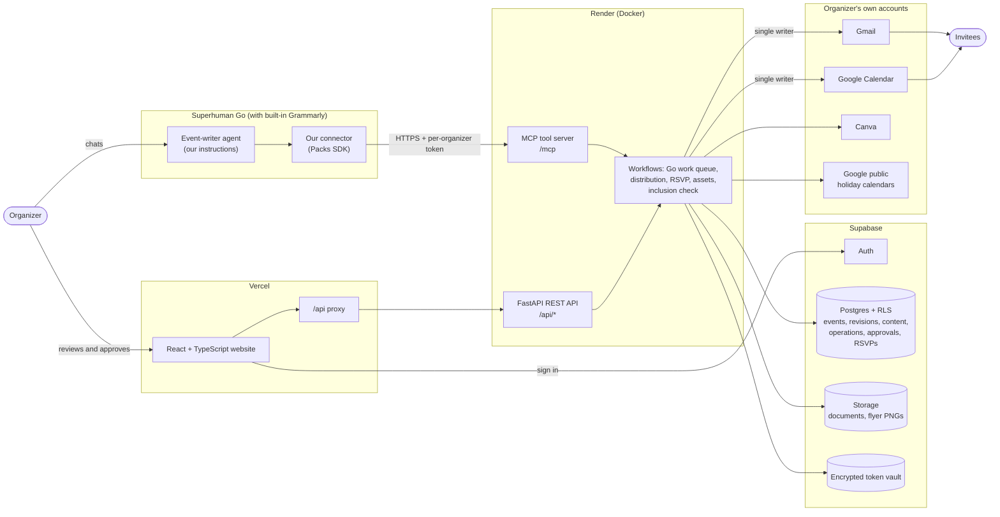
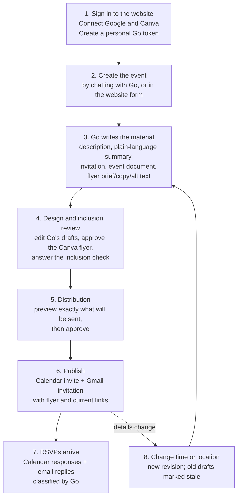

# Project overview: Event Workspace

A one-page guide to what we built, how it fits together, and how an organizer uses it. Written for judges, teammates and the pitch. Built for [MTC x Grammarly: Agents in Action](https://mtc-x-grammarly.devpost.com/), October 16, 2026. The product name is still undecided; the website currently calls itself **Event Workspace**.

- **Website:** https://mtcxhackathon1.vercel.app
- **Backend API and MCP server:** https://superhuman-go-event-backend.onrender.com (free tier: wake it with `/api/health` before a demo)

## The problem, in one sentence

An event's details live in five places (calendar invite, email, flyer, event document, the organizer's notes), so when the room or time changes an hour before, someone always ends up with the old version.

## What it does

The organizer enters an event **once**. **Superhuman Go** writes every piece of prose and coordinates the work. The organizer reviews it, runs an inclusion check, and approves sending. When details change, the same Calendar event is updated, a change notice goes out by email, a new flyer version is made, and the website shows which materials are current and which still need attention.

Three ideas carry the design:

1. **One source of truth.** Every event is a versioned record in Supabase. Every email, flyer and document is stamped with the revision it was made from, so stale material is visible instead of hidden.
2. **Go writes, the organizer decides.** Go drafts all prose (descriptions, summaries, invitations, change notices, event documents, flyer copy) and classifies RSVP replies. Nothing goes to Calendar or Gmail until the organizer clicks approve in the website.
3. **Inclusion is part of the workflow, not a footnote.** Before sending, the organizer checks step-free access, elevator, food, captions, loud sound/strobes and religious-holiday conflicts. Unknown facts stay marked *unknown*; we never invent an accommodation.

## The stack



| Layer | Technology | What it does |
| --- | --- | --- |
| AI agent | **Superhuman Go** with built-in Grammarly | Writes all event prose, creates/edits events when asked, classifies RSVP replies. Configured with our [agent instructions](../integrations/superhuman/agent/INSTRUCTIONS.md). |
| Agent connector | Superhuman **Packs SDK** (`integrations/superhuman/`) | Gives Go authenticated access to our MCP tools over HTTPS. |
| Website | **React 19 + TypeScript**, Vite, hosted on **Vercel** (`frontend/`) | Organizer dashboard: event details, design and inclusion review, distribution approval, RSVPs, connected services. A Vercel function proxies `/api` to the backend. |
| Backend | **Python 3.11, FastAPI**, FastMCP, hosted on **Render** in Docker (`backend/`) | REST API for the website and MCP tools for Go, sharing one set of workflow services. |
| Data | **Supabase** Auth, Postgres with row-level security, Storage (`supabase/`) | Canonical versioned events, Go's generated content, approvals, operations with provider receipts, RSVPs, encrypted OAuth tokens, stored documents and flyer exports. |
| Providers | **Google Calendar, Gmail, Canva** (per-organizer OAuth) | Calendar invites and RSVP statuses; invitation and change-notice emails; custom flyer designs and PNG exports. |
| Inclusion data | Google's public **Christian, Jewish, Muslim, Hindu and Orthodox Christian** holiday calendars | Flags events that clash with major religious observances in the event's timezone. |

### Why it's built this way

- **Go is the writer; our backend is the hands.** Go reaches our system through MCP tools, which is the supported way to extend Go. It doesn't need an API to "call" Go from our server, and we didn't invent one.
- **The backend is the only thing that writes to Calendar and Gmail.** It records every provider ID (Calendar event ID, Gmail draft/message/thread IDs, Canva design and export IDs), so retries never create a second invite or a duplicate email.
- **Every organizer is isolated.** The website uses Supabase sessions; Go uses a personal connector token that resolves to one organizer. Tokens and OAuth secrets stay on the server, encrypted.

## The user flow

### Organizer journey



The website walks the organizer through three steps for each event: **Event details → Design & inclusion → Distribution**, with a status panel that shows every artifact's revision and state (`awaiting Go`, `needs review`, `ready`, `succeeded`, `failed`, `stale`).

**Step by step:**

1. **Sign in and connect.** The organizer signs in (Supabase Auth). Under **Settings → Connected services** they connect Google (Gmail and Calendar) and their own Canva. They create a personal Go token and paste it into the connector inside Superhuman Go.
2. **Create the event.** Either tell Go "Create an event: Intro to Robotics workshop, Oct 24 3–5 PM PT, Soda Hall 306", or fill in the website form. Go restates the details and asks for confirmation before saving, then replies with a link straight to the event in the website.
3. **Go writes.** The website queues writing work. The organizer tells Go "Process my event work." Go reads the event, writes each piece, and saves it against the current revision. Each piece arrives marked *needs review*.
4. **Design and inclusion review.** The organizer reads and edits Go's drafts. Go creates a custom Canva flyer from its own brief; the website shows a preview with the exact title, time and location, and only the organizer can approve it. The inclusion check asks about entrance, elevator, food, captions, loud sound and strobes (each *yes / no / unknown*, with a source and date) and automatically checks the five holiday calendars.
5. **Distribution preview.** "What sending will do" lists the planned actions (create or update Calendar event, send or replace email) and any blockers, such as unreviewed writing or a missing Google connection.
6. **Publish.** The organizer approves. The backend creates the Calendar event with attendees, then sends the Go-written invitation by Gmail, including the Calendar link and the approved flyer. Every result is stored with its provider receipt.
7. **RSVPs.** Calendar responses sync automatically. Email replies are classified by Go as attending, maybe or not attending. Unclear replies stay *needs review*, and any dietary or accessibility notes stay private to the organizer.

### What happens when the details change

This is the moment the product exists for.

```mermaid
sequenceDiagram
    actor O as Organizer
    participant G as Superhuman Go
    participant W as Website
    participant B as Backend
    participant P as Calendar / Gmail / Canva

    O->>G: "Move the workshop to 4 PM, room 405"
    G->>B: update_event (expected revision 1)
    B-->>G: revision 2, old drafts and flyer marked stale
    G-->>O: Saved. Link to the event. Nothing sent yet.
    O->>G: "Process my event work"
    G->>B: get_event, then save change notice + new flyer copy (rev 2)
    O->>W: Review change notice and new flyer, approve
    W->>B: approval for revision 2
    B->>P: Update the SAME Calendar event ID
    B->>P: Email: replace unsent draft, or send a new change notice in the same thread
    B->>P: New Canva flyer version + new PNG export
    B-->>W: Receipts for each step; any failure shown and retryable
```

- The **Calendar event keeps its ID**, so attendees see an update instead of a second invite.
- If the original email was **already sent**, the old email stays in history and a **new change notice** goes out in the same thread. If it was still a draft, the draft is replaced.
- Already-delivered attachments can't change, so a **new flyer export** is made and the event's current link always points to the latest version.

### The invitee's experience

Invitees get a Calendar invitation and an email with the details, a plain-language summary and the flyer. They RSVP by accepting the Calendar invite or simply replying to the email ("yes, I'll be there"). If the event changes, their calendar updates in place and they receive a clear email that leads with what changed.

## Where Superhuman Go fits

Go is central: every word sent to an invitee is written by Go, and Go is the main way an organizer operates the system. The connector exposes these tools:

| Purpose | Tools |
| --- | --- |
| Create and edit events and tasks | `list_events`, `create_event`, `update_event`, `list_tasks`, `create_task`, `update_task` |
| Write the material | `list_go_work`, `claim_go_work`, `get_event`, `save_generated_content` |
| Flyer and document | `get_event_assets`, `request_asset_prose`, `prepare_event_document`, `start_canva_flyer`, `poll_canva_flyer`, `preview_canva_flyer`, `export_canva_flyer` |
| Send (only with the organizer's approval ID) | `preview_distribution`, `execute_distribution` |
| RSVPs | `sync_rsvps`, `get_reply`, `record_rsvp_classification`, `list_rsvps` |

Guard rails built into the tools and Go's instructions: Go can't approve a flyer or send anything on its own; every write checks the expected revision; Go uses only facts from the event record; and invitee emails and private needs never appear in Go's prose.

## Status (as of October 16, 2026, evening)

What we can show, labeled honestly:

| Capability | Evidence |
| --- | --- |
| Go writes event prose through our MCP tools | **Live** (dev mode, in-memory store): Go saved a description, summary, invitation and change notice |
| Publish to Calendar + Gmail | **Live** (dev mode): real Calendar event and Gmail send to a test inbox; retry doesn't duplicate |
| Change time/location | **Live** (dev mode): same Calendar ID updated; change notice in the same Gmail thread |
| RSVP sync | **Live** (dev mode) for Calendar statuses; email-reply classification tested with mocks |
| Hosting | Website on Vercel and backend on Render both answer `/api/health` |
| Supabase persistence, Canva flyer export, inclusion editing | Implemented and tested with mocks and local SQL checks; full live run on Supabase is the final rehearsal ([MASTER_TODO M8](MASTER_TODO.md)) |
| Tests | About 350 backend tests (pytest) and 65 frontend tests (Vitest), plus Supabase isolation SQL tests in CI |

[MASTER_TODO.md](MASTER_TODO.md) is the live checklist; this page will lag behind it.

## Repository map

| Path | Contents |
| --- | --- |
| `frontend/` | React website, Vercel proxy (`api/proxy.ts`) |
| `backend/src/hackathon_backend/api/` | REST routes for the website |
| `backend/src/hackathon_backend/mcp_tools/` | Go's event and organizer tools |
| `backend/src/hackathon_backend/workflows/` | Go work queue, distribution, RSVP, asset coordinator, OAuth connect |
| `backend/src/hackathon_backend/providers/` | Google Calendar/Gmail and Canva clients |
| `backend/src/hackathon_backend/services/` | Inclusion check (holiday calendars) and assets (documents, Storage, attachments) |
| `supabase/` | Schema migrations, RLS, isolation tests |
| `integrations/superhuman/` | Go connector and the agent's instructions |
| `render.yaml`, `backend/Dockerfile` | Backend deployment |

To run locally, see the [README](../README.md); for Go setup, see [SUPERHUMAN.md](SUPERHUMAN.md); for the 2-minute pitch script, see [PRESENTATION.md](PRESENTATION.md).

## Credits and disclosure

Built by a team of four during the hackathon. The repository started from a pre-event scaffold (React/Python/MCP starter, Go connector skeleton, deployment tooling), disclosed in [HACKATHON.md](HACKATHON.md#existing-work-disclosure).
