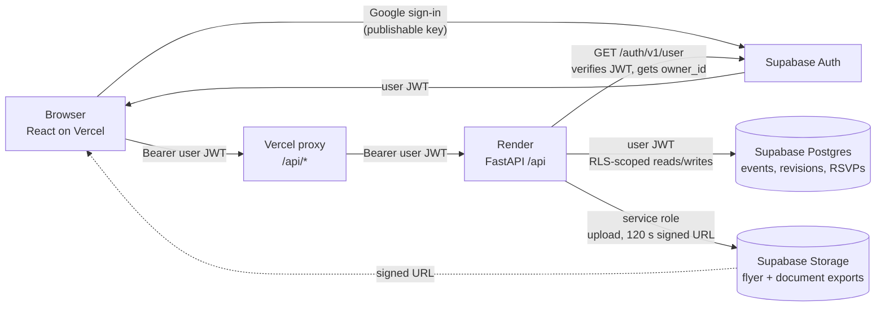
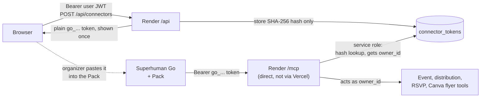
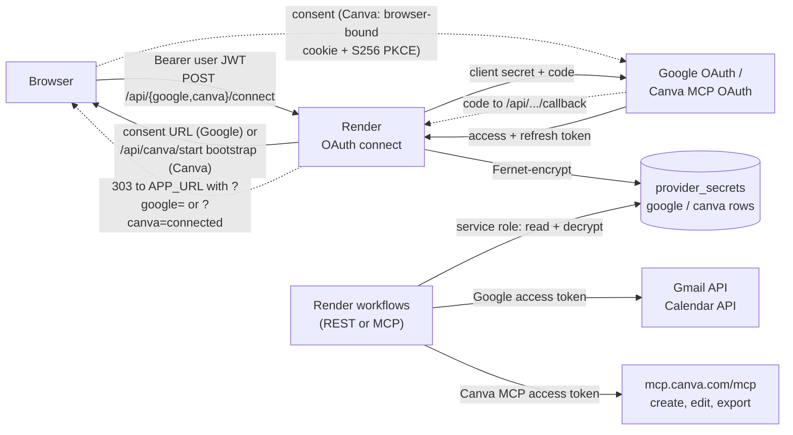

# Token and server flow

Which server holds which credential, and which hop carries it. Read with [architecture](ARCHITECTURE.md) and the [master to-do](MASTER_TODO.md). This document records names only, never values.

## Tech stack

| Layer | Technology | Hosted on | Code |
| --- | --- | --- | --- |
| Organizer website | React 19, TypeScript, Vite, Vitest | Vercel (`mtcxhackathon1.vercel.app`) | `frontend/src/**` |
| Website proxy | Vercel server functions forwarding `/api/*` and `/mcp` | Vercel | `frontend/api/*.ts`, `frontend/server/proxy.ts` |
| Backend API | Python, FastAPI, uvicorn, httpx | Render (`superhuman-go-event-backend.onrender.com`) | `backend/src/hackathon_backend/**` |
| Go tool server | Python MCP SDK, streamable HTTP at `/mcp` | Render, same process | `mcp_tools/**`, `main.py` |
| Go connector | Superhuman Go Packs SDK (TypeScript) | Superhuman | `integrations/superhuman/**` |
| Identity, data, files | Supabase Auth, Postgres with RLS, Storage | Supabase | `supabase/migrations/**` |
| Credential vault | Fernet-encrypted rows in `provider_secrets` | Supabase Postgres (encrypted by the backend) | `repositories/vault.py` |
| Providers | Gmail, Google Calendar, Canva MCP (`mcp.canva.com/mcp`, MCP OAuth) | Google, Canva | `providers/google/**`, `providers/canva/**` |

## Servers and tokens

Solid arrows are requests, and each label names the credential it carries. Dashed arrows are browser redirects or manual steps. Render's env holds `SUPABASE_SERVICE_ROLE_KEY`, `CREDENTIAL_ENCRYPTION_KEY`, `GOOGLE_CLIENT_ID/SECRET` and `CANVA_CLIENT_ID/SECRET`; none of these leave the backend.

### 1. Website: organizer session

### 2. Superhuman Go: connector token

### 3. Providers: per-organizer OAuth, then server-side calls

## Credential inventory

| Credential | Created by | Stored at | Sent to | Never reaches |
| --- | --- | --- | --- | --- |
| Supabase publishable key | Supabase project | `VITE_SUPABASE_PUBLISHABLE_KEY` (public build) and the backend env | Supabase Auth / PostgREST | (public by design) |
| Supabase user JWT | Supabase Auth at Google sign-in | Browser session | Vercel proxy → backend → Supabase (RLS) | Go, providers |
| Supabase service-role key | Supabase project | Render env only | Supabase (vault, `connector_tokens`, Storage, flyer jobs) | Browser, Vercel, Go |
| Go connector token `go_…` | `POST /api/connectors`, per organizer, expiring and revocable | Plain value lives in Go's Pack auth only; Postgres keeps its SHA-256 hash | Go → Render `/mcp` (the Pack calls Render directly) | Providers |
| `CREDENTIAL_ENCRYPTION_KEY` (Fernet) | Generated on the server | Render env only | Nowhere (encrypts and decrypts vault rows in-process) | Supabase, browser |
| Google client ID/secret | Google Cloud console | Render env | Google token endpoint | Browser, Go |
| Google refresh token | Organizer consent (`gmail.compose`, `gmail.readonly`, `calendar.events`) | `provider_secrets` row `google`, Fernet-encrypted | Google token endpoint, then short-lived access tokens to the Gmail and Calendar APIs | Browser, Go, Git |
| Canva client ID/secret | Canva developer portal: MCP app "Event Workspace" (REST integration disabled); see [Canva OAuth setup](canva/OAUTH_SETUP.md) | Render env (`CANVA_*`, which is also what registers the `/api/canva/*` routes) | Canva's MCP token endpoint (client Basic auth) | Browser, Go |
| Canva access/refresh token | Organizer consent via S256 PKCE, bound to the `/mcp` resource | `provider_secrets` row `canva`, Fernet-encrypted; refreshed shortly before expiry and the rotated refresh token is saved | `mcp.canva.com/mcp` only (not reused for Canva REST) | Browser, Go, Git |
| Signed Storage URL | Backend, per request | Not stored; valid for 120 s | Browser (flyer preview/download) | (short-lived by design) |

## Why each hop is shaped this way

- **The browser holds only its own session.** The website is a public client: `VITE_*` values ship in the bundle, so no provider or service-role secret ever goes there.
- **Go never sees provider tokens.** Go authenticates as an organizer with the `go_…` token. The backend maps that to `owner_id` and then uses that organizer's vault entries. Gmail, Calendar and Canva calls happen on Render, so the backend can record revisions and receipts and keep retries idempotent.
- **Supabase stores encrypted provider secrets but can't read them.** The Fernet key lives only on Render, so a database leak alone does not expose Google or Canva tokens.
- **The OAuth callbacks are browser redirects with no bearer token.** A single-use `state` value bound to `owner_id` identifies the organizer. Canva also needs the PKCE verifier and a browser-bound cookie set by `/api/canva/start`, so connect from the website, not from a copied link. The callback then redirects to `APP_URL/?google|canva=connected|error`.

## Known gaps

- Pending OAuth `state` and Canva refresh serialization live in backend process memory. Run one Render worker; a restart drops consents that are still in flight.
- Hosted Canva consent is unverified (A7). A Canva export that is still pending keeps its job ID but can't be polled yet, because the MCP token isn't used as a REST token and no separate authorized poll reader exists.
- Grants made before the `/mcp` resource marker require reconnecting.
- `WORKFLOW_DEV_MODE` with `DEV_CONNECTOR_TOKEN` is a single global token for isolated demos only. It does not provide multi-user authorization.
